

  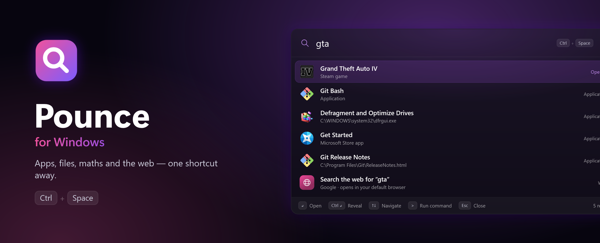

  
  
  
  
  
  
  

  <b>The launcher from Hutch, now on Windows.</b> 
  Press <kbd>Ctrl</kbd>+<kbd>Space</kbd> anywhere, type a few letters, and hit <kbd>Enter</kbd>. 
  Apps, files, open windows, your clipboard, maths, conversions and the web, all from one box.

  <a href="https://github.com/Coursion-Studio/pounce-windows/releases/latest"><b>⬇ Download Pounce</b></a>
  &nbsp;·&nbsp; <a href="#-install">Install</a>
  &nbsp;·&nbsp; <a href="#-features">Features</a>
  &nbsp;·&nbsp; <a href="#-themes--styles">Themes</a>
  &nbsp;·&nbsp; <a href="#%EF%B8%8F-shortcuts">Shortcuts</a>
  &nbsp;·&nbsp; <a href="#-faq">FAQ</a>

---

  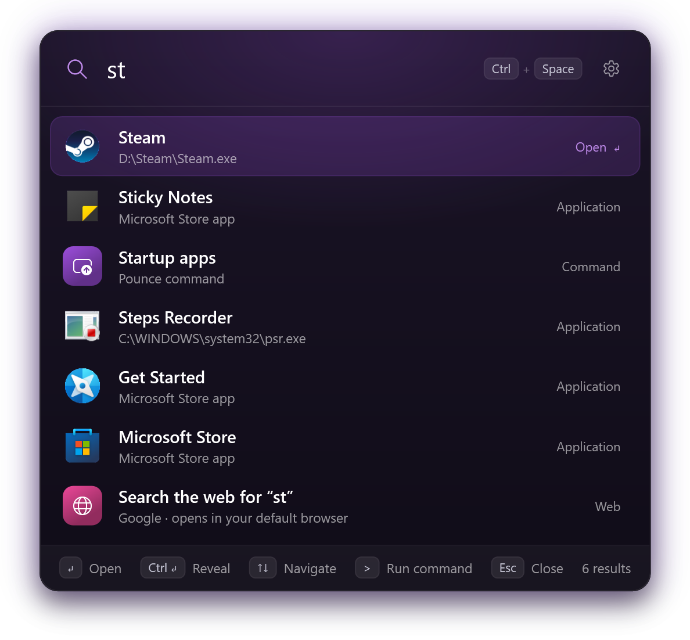

## 🚀 Install

1. Download **`PounceSetup-x.y.z.exe`** from the [latest release](https://github.com/Coursion-Studio/pounce-windows/releases/latest).
2. Open it and click **Install**. Pounce installs just for you, so **no admin rights** are needed.
3. Press <kbd>Ctrl</kbd>+<kbd>Space</kbd>. Pounce lives in the system tray.

  
  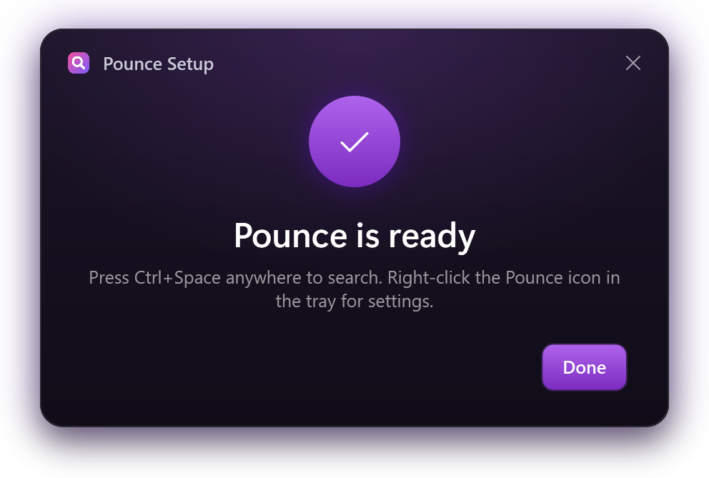

Setup adds Pounce to the **Start menu**, can **start it with Windows**, and registers it under
**Settings → Apps → Installed apps**. After that, Pounce **updates itself**: it checks once a day,
shows what's new, and installs with one click. Every update is signed by Coursion Studio.

> **"Windows protected your PC"?** This SmartScreen warning appears because the installer isn't code-signed yet.
> Click **More info → Run anyway**. Each release includes a `.sha256` file so you can verify the download.

**Uninstall:** go to **Settings → Apps → Installed apps → Pounce → Uninstall**. You can choose whether to keep your settings and history.

**Requirements:** Windows 10 or 11. .NET Framework 4.8 is already part of Windows, so there's nothing else to install.

## ✨ Features

|   |   |
|---|---|
| 🚀 **Apps** | Every installed app, desktop and Microsoft Store, with its real icon. Fuzzy matching: `vsc` finds Visual Studio Code. |
| 📄 **Files** | Everything Windows indexes, or every drive instantly when [Everything](https://www.voidtools.com) is running. |
| 🪟 **Window switcher** | Type part of a window's title or app and jump straight to it. |
| 📋 **Clipboard history** | The last 50 things you copied, text and images. <kbd>Enter</kbd> pastes. |
| 🎯 **Scopes** | `apps:`, `files:`, `windows:`, `clipboard:`, `web:`, `actions:`, `snippets:` search just one thing. |
| 🧮 **Maths & conversions** | `12*7+sqrt(16)`, `5 km in miles`, `72f to c`, `100 usd to try`. |
| ⚙️ **System actions** | Dark mode, volume, sleep, lock, restart, shut down, empty Recycle Bin, screenshot. |
| ✂️ **Snippets & quick links** | `;date` pastes today's date; `gh pounce`, `yt`, `wiki`, `maps` open searches. |
| ⌨️ **Commands** | `> ipconfig` runs it in Command Prompt. |
| 🌐 **Web** | Type `github.com` to open it, or search Google in your default browser. |
| 🎨 **15 themes, 3 styles, your own colour** | Pick a palette, or build a theme from any colour on screen. |
| 🌍 **14 languages** | Follows Windows, or pick one in Settings. |
| 🔒 **Private** | No account, no analytics, no telemetry. |

### 🎯 Scopes

Type a prefix such as `apps:` and it turns into a coloured chip in the search field, just like Pounce on the Mac.
From then on Pounce searches only that kind of thing, and the hint text tells you what to type.
Press <kbd>Backspace</kbd> in an empty field, press <kbd>Esc</kbd>, or click the chip to leave the scope.

Not sure which prefix? Type `:` to see them all, and press <kbd>Enter</kbd> on one to switch to it.

  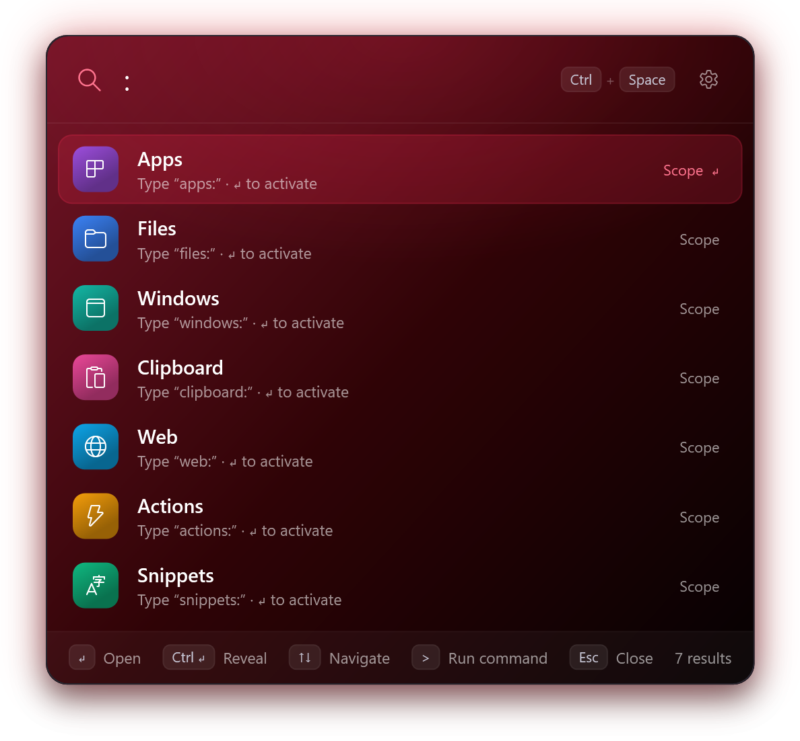
  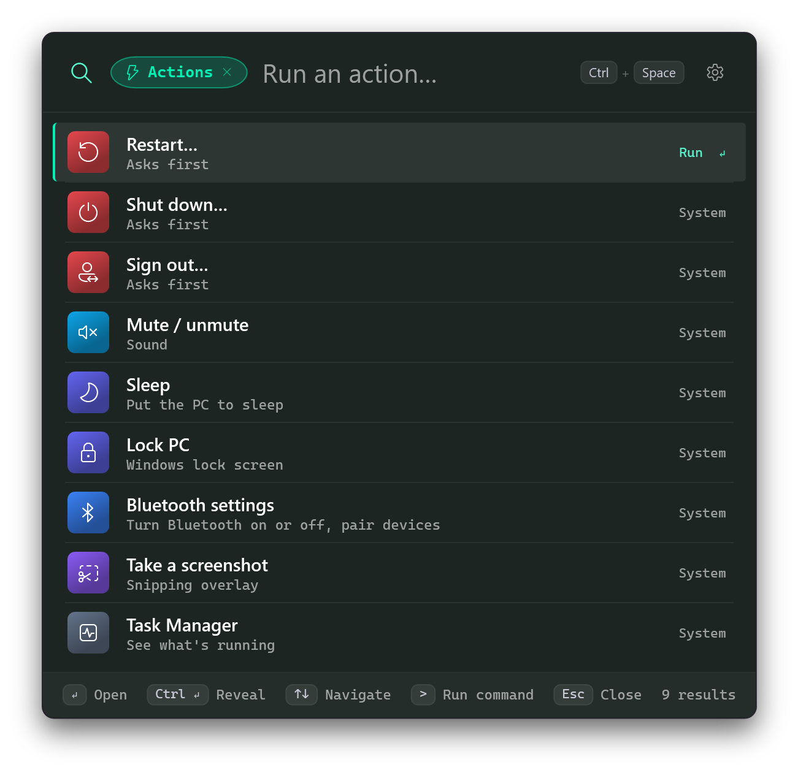

| Prefix | Searches | Also works |
|---|---|---|
| `apps:` | Installed apps | `app:` |
| `files:` | Files and folders | `file:` |
| `windows:` | Open windows | `win:` |
| `clipboard:` | Clipboard history | `clip:` `clips:` |
| `web:` | The web | `google:` |
| `actions:` | System actions | `action:` `do:` `sys:` |
| `snippets:` | Snippets and quick links | `snip:` |

Drive paths such as `c:\` still search files, as before.

### 🪟 Window switcher

Type part of a window's title or its app, such as `edge trip`, and <kbd>Enter</kbd> brings it to the front,
even if it's minimised. `windows:` lists every open window.

  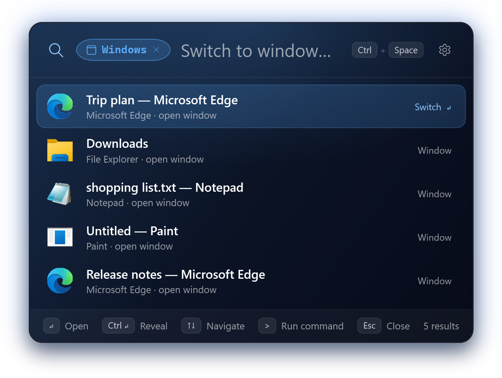

### 📋 Clipboard history

Type `clipboard:` (or just `clip`) to see the last 50 things you copied, text and images. <kbd>Enter</kbd> pastes it
into the window you were using. History is stored only on your PC, encrypted with your Windows account, and copies from
password managers are skipped. Turn it off or clear it in **Settings → Search**.

  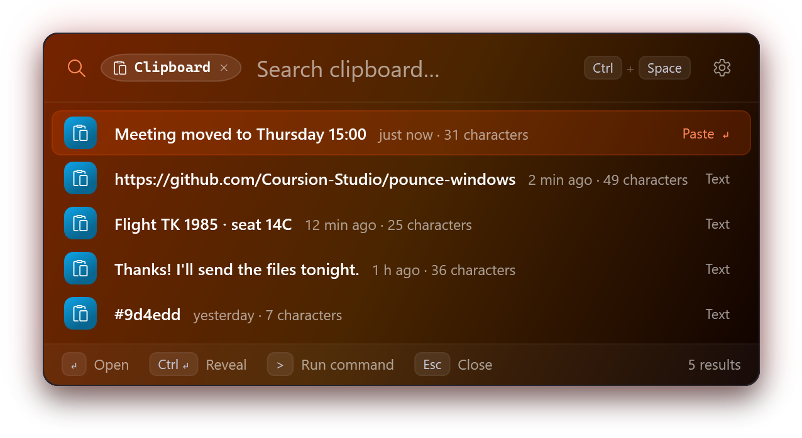

### 🧮 Maths and conversions

The answer appears as you type, and <kbd>Enter</kbd> copies it.

- **Maths:** `12*7+sqrt(16)`, `2^10`, `(1+2)*3`, `3,5+1`
- **Units:** `5 km in miles`, `72f to c`, `2 gb in mb`, `3 cups to ml`, `10 kg in lb`
- **Currency** (opt-in, Settings → Search): `100 usd to try`, with daily European Central Bank rates

  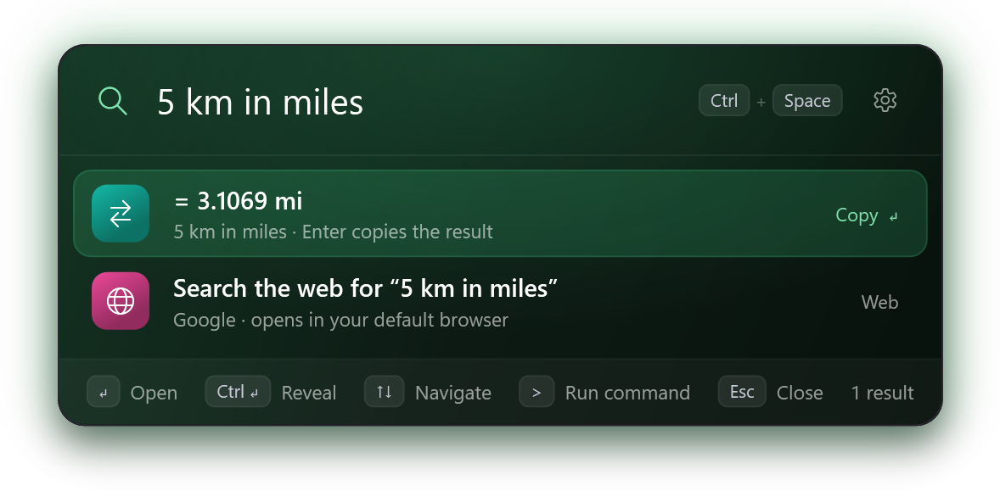
  

### ⚙️ System actions

Dark mode on or off, volume up, down and mute, sleep, lock, restart, shut down and sign out
(those three ask first), empty the Recycle Bin, Wi-Fi and Bluetooth settings, take a screenshot, Task Manager.
Type what you want, such as `dark` or `lock`, or `actions:` to see them all.

### ✂️ Snippets and quick links

- **Snippets** paste saved text: type `;` and the keyword. `;date`, `;time` and `;now` are built in; add your own, such as `;addr` for your address.
- **Quick links** search a site: `gh pounce` searches GitHub, plus `yt`, `wiki` and `maps`. Add your own with `{q}` where the search goes.

Manage both in **Settings → Snippets & quick links**.

  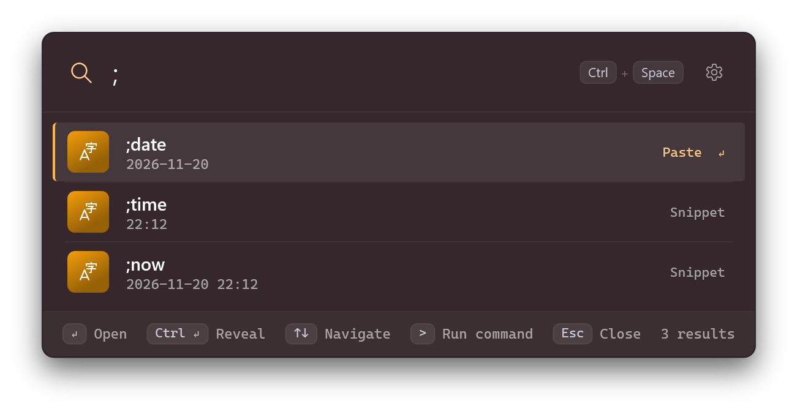
  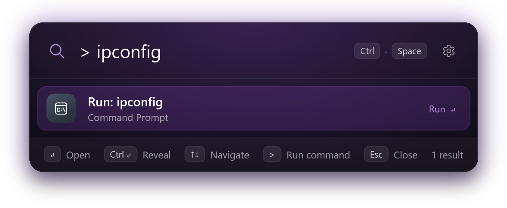">

## 🎨 Themes & styles

15 themes, the same palettes as Pounce in Hutch. Pick one in **Settings → Appearance**, or type `theme` in Pounce
to switch live.

  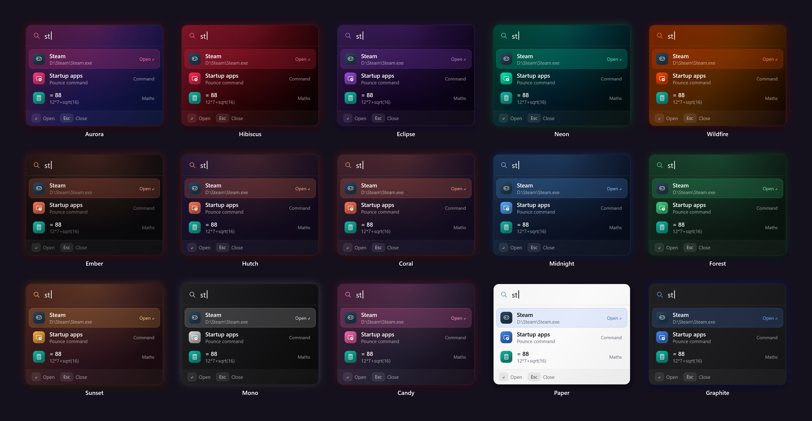

Each theme comes in three styles: **Glass** (frosted, with the colour flowing through), **Ledger** (flat ink,
hairline rules, monospace labels) and **Compact** (one-line rows, more results at a glance).

  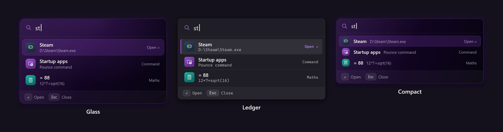

**Your own theme:** click **Custom colour…** to pick any colour, or **Pick from screen** to click any pixel,
and Pounce builds a whole theme from it, dark or light. In Pounce, type `theme #ff7a59` or `theme pick`.
Settings, the tray menu and every Pounce window follow your theme.

## 🌍 Languages

English, Deutsch, Español, Français, Italiano, Português (Brasil), Nederlands, Polski, Türkçe, Русский,
Українська, 日本語, 한국어 and 简体中文. Pounce follows your Windows language; change it in
**Settings → General → Language**.

  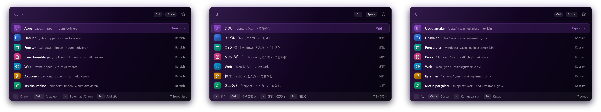

## 📸 More screenshots

  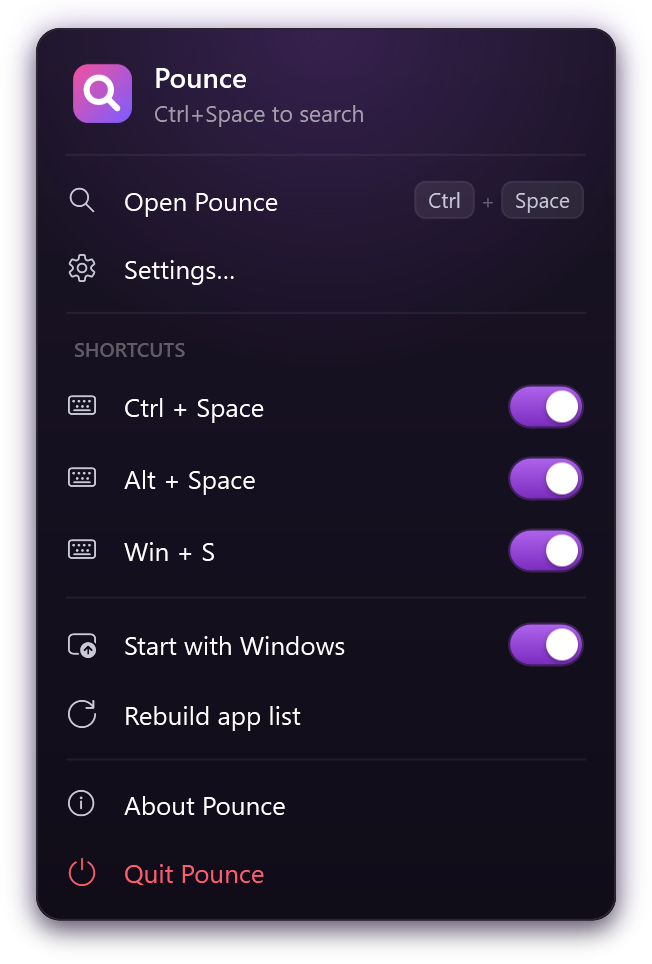
  

  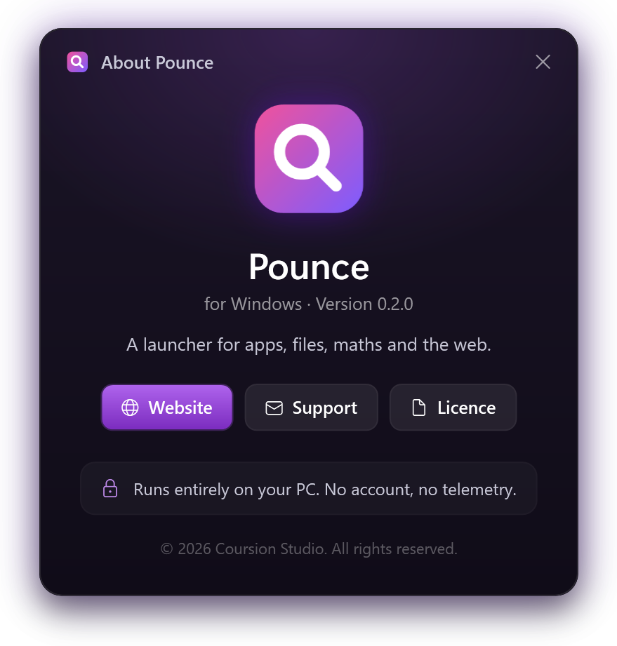

## ⌨️ Shortcuts

| Action | Default |
|---|---|
| **Open Pounce** | <kbd>Ctrl</kbd>+<kbd>Space</kbd> · <kbd>Alt</kbd>+<kbd>Space</kbd> · <kbd>Win</kbd>+<kbd>S</kbd> · left-click the tray icon |
| Open the selected result | <kbd>Enter</kbd> |
| Show in Explorer | <kbd>Ctrl</kbd>+<kbd>Enter</kbd> |
| Move through results | <kbd>↑</kbd> <kbd>↓</kbd> · <kbd>Tab</kbd> |
| Clear search / leave a scope / close | <kbd>Esc</kbd> |
| Settings | <kbd>Ctrl</kbd>+<kbd>,</kbd> · the ⚙ button · right-click the tray icon |
| Search just one thing | Type a prefix such as `apps:` · or `:` to pick a scope |
| Leave a scope | <kbd>Backspace</kbd> in an empty field · click the chip |
| Run a command | Start with `>` |
| Clipboard history | `clipboard:` or `clip` |
| Paste a snippet | `;` and its keyword, e.g. `;date` |
| More actions on a result | Right-click it · or the keyboard's menu key |
| Move the bar | Drag its top edge or the bottom hint bar · double-click either to re-centre |
| Change theme / style | Type `theme` or `style` · right-click the bar · Settings → Appearance |

Each shortcut can be turned off in **Settings → Shortcuts**. You can also make a single tap of the <kbd>Win</kbd> key open Pounce instead of Start.

## ❓ FAQ

<b>Ctrl+Space doesn't autocomplete in my code editor any more.</b>

While Pounce is running, it takes <kbd>Ctrl</kbd>+<kbd>Space</kbd>. Turn that shortcut off in **Settings → Shortcuts** and use <kbd>Alt</kbd>+<kbd>Space</kbd> instead.

<b>The shortcut doesn't work while an admin window is in front.</b>

Windows doesn't let normal apps see the keyboard while a window running **as administrator** is focused. Turn on
**Settings → General → Work over admin windows**: Pounce then starts with admin rights at sign-in. It asks for permission once.

<b>Is my clipboard history safe?</b>

It never leaves your PC. It's encrypted with your Windows account, copies from password managers are skipped,
and you can clear it or turn it off at any time in **Settings → Search**.

<b>Can I hide the Windows search box on the taskbar?</b>

Yes: *Settings → Personalization → Taskbar → Search → Hide*. To remove the news and quizzes from Windows Search, turn off *Settings → Privacy & security → Search permissions → Show search highlights*.

<b>A file I know exists doesn't show up.</b>

Without Everything, Pounce uses the Windows Search index. Files in hidden folders (like `.git`) or in `AppData` are
skipped on purpose. If a folder is missing, check *Settings → Privacy & security → Searching Windows*, or install
[Everything](https://www.voidtools.com) and turn on **Settings → Search → Search all drives with Everything**.

<b>An app I just installed doesn't appear.</b>

The app list refreshes every 10 minutes. To refresh it now, right-click the tray icon and choose **Rebuild app list**.

<b>Does Pounce connect to the internet?</b>

Only to check for updates once a day and, if you turn on currency conversion, to fetch exchange rates once a day.
No account, no analytics, no telemetry.

<b>Where are my settings stored?</b>

Settings and history are in `%AppData%\Coursion\Pounce`. Pounce itself is installed in `%LocalAppData%\Programs\Pounce`.

## 🐛 Issues & feedback

Open an issue on this repo, or email [support@coursion.studio](mailto:support@coursion.studio).
The source code lives in a private repo. This one hosts the releases, the update feed and this page.

## 📄 Licence

Proprietary. See [LICENSE.md](LICENSE.md). © 2026 Coursion Studio. All rights reserved.
Questions: [support@coursion.studio](mailto:support@coursion.studio) · [coursion.studio](https://coursion.studio)
