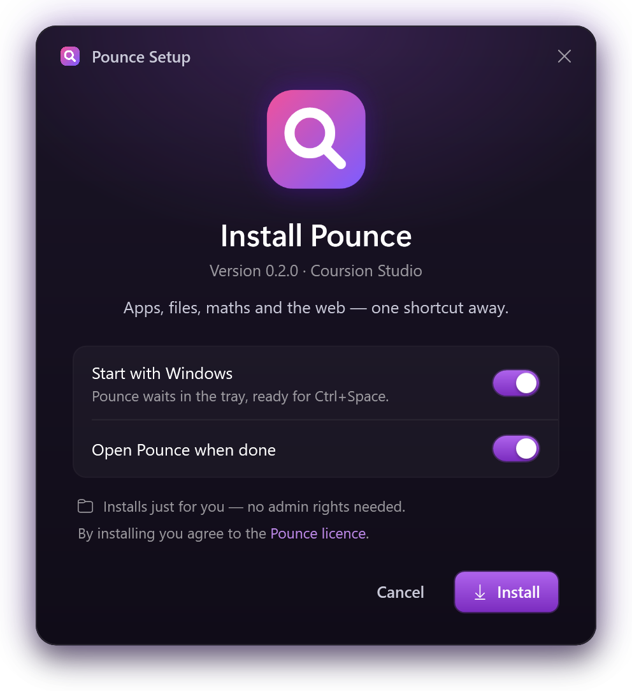
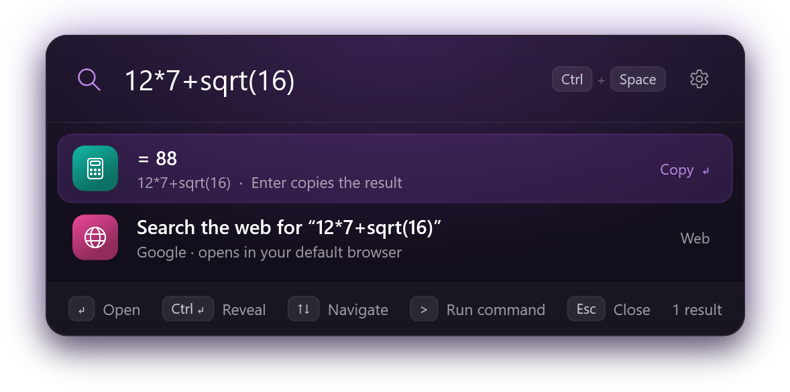
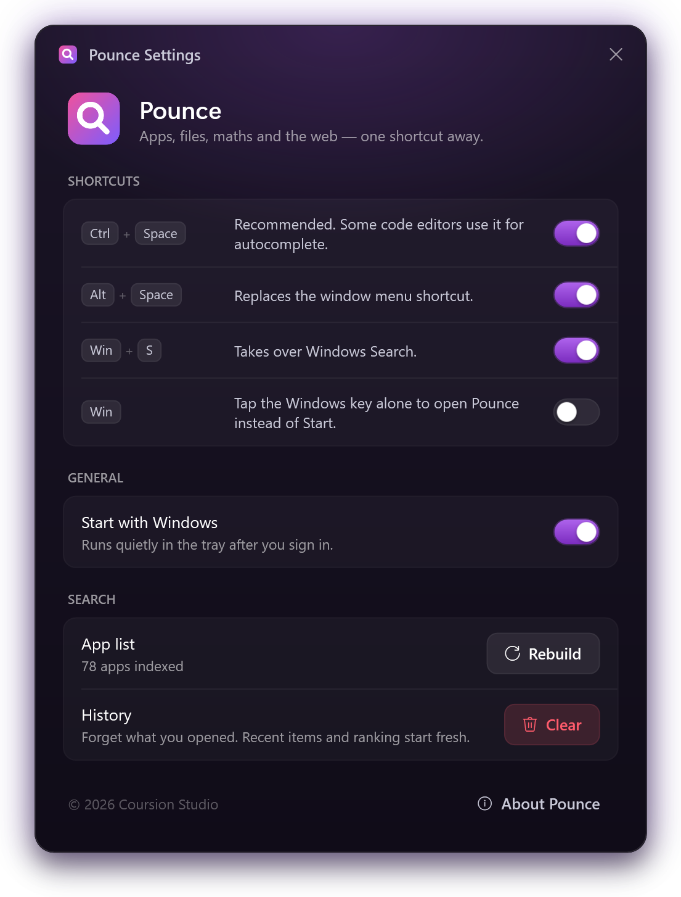

  

  
  
  
  
  
  

  <b>The launcher from Hutch, now on Windows.</b> 
  Press <kbd>Ctrl</kbd>+<kbd>Space</kbd> anywhere, type a few letters, and hit <kbd>Enter</kbd>. 
  Apps, files, maths, websites and commands, all from one box.

  <a href="https://github.com/Coursion-Studio/pounce-windows/releases/latest"><b>⬇ Download Pounce</b></a>
  &nbsp;·&nbsp; <a href="#-install">Install</a>
  &nbsp;·&nbsp; <a href="#-features">Features</a>
  &nbsp;·&nbsp; <a href="#-screenshots">Screenshots</a>
  &nbsp;·&nbsp; <a href="#%EF%B8%8F-shortcuts">Shortcuts</a>
  &nbsp;·&nbsp; <a href="#-faq">FAQ</a>

---

  

## 🚀 Install

1. Download **`PounceSetup-x.y.z.exe`** from the [latest release](https://github.com/Coursion-Studio/pounce-windows/releases/latest).
2. Open it and click **Install**. Pounce installs just for you, so **no admin rights** are needed.
3. Press <kbd>Ctrl</kbd>+<kbd>Space</kbd>. Pounce lives in the system tray.

  
  

Setup adds Pounce to the **Start menu**, can **start it with Windows**, and registers it under
**Settings → Apps → Installed apps**. Running a newer `PounceSetup` **updates Pounce in place** and keeps your settings.

> **"Windows protected your PC"?** This SmartScreen warning appears because the installer isn't code-signed yet.
> Click **More info → Run anyway**. Each release includes a `.sha256` file so you can verify the download.

**Uninstall:** go to **Settings → Apps → Installed apps → Pounce → Uninstall**. You can choose whether to keep your settings and history.

**Requirements:** Windows 10 or 11. .NET Framework 4.8 is already part of Windows, so there's nothing else to install.

## ✨ Features

|   |   |
|---|---|
| 🚀 **Apps** | Every installed app, desktop and Microsoft Store, with its real icon. Fuzzy matching: `vsc` finds Visual Studio Code and `snip` finds Snipping Tool. |
| 📄 **Files** | Everything Windows indexes, or every drive instantly when [Everything](https://www.voidtools.com) is running. <kbd>Ctrl</kbd>+<kbd>Enter</kbd> shows the file in Explorer. |
| 🧮 **Maths** | Type `12*7+sqrt(16)`, `2^10`, `(1+2)*3` or `3,5+1`, and <kbd>Enter</kbd> copies the result. |
| 🌐 **Web** | Type `github.com` to open it directly, or search Google in your default browser. |
| 🪟 **Window switcher** | Type part of a window's title or app, such as `chrome docs`, and jump straight to it. `:win` lists every open window. |
| 📋 **Clipboard history** | Type `clip` for the last 50 things you copied, text and images; <kbd>Enter</kbd> pastes. Encrypted on your PC, password-manager copies skipped. |
| 📏 **Conversions** | `5 km in miles`, `72f to c`, `2 gb in mb`, `3 cups to ml`. Currency (`100 usd to try`) is opt-in, with daily ECB rates. |
| 🎯 **Scopes** | Type `:` to search one thing: `:apps` `:files` `:win` `:clip` `:web` `:sys` `:snip`. |
| ⚙️ **System actions** | Dark mode, volume, sleep, lock, restart and shut down (they ask first), empty Recycle Bin, Wi-Fi, Bluetooth, screenshot. |
| ✂️ **Snippets & quick links** | `;date` or your own `;addr` pastes text; `gh pounce`, `yt`, `wiki`, `maps` open searches. Add your own in Settings. |
| ⌨️ **Commands** | `> ipconfig` runs it in Command Prompt. Downloads, Documents, Startup apps and more are built in. |
| 🕘 **Recent** | An empty search shows what you opened last (as a list, a button, or not at all), and the apps you use most rank higher. |
| 🎨 **15 themes, 3 styles** | The same palettes as Pounce in Hutch, from Aurora to Paper, in Glass, Ledger or Compact. Type `theme` to switch live. |
| 🖱️ **Right-click** | Run as administrator, show in Explorer, copy path or link, remove from recents. |
| 🌍 **14 languages** | English, Deutsch, Español, Français, Italiano, Português, Nederlands, Polski, Türkçe, Русский, Українська, 日本語, 한국어, 简体中文. |
| 🔄 **Automatic updates** | Checks once a day, shows what's new, and installs with one click. Every update is signed by Coursion Studio. |
| 🔒 **Private** | Runs entirely on your PC. No account, no analytics, no telemetry. The only network calls are the daily update check and, if you turn it on, exchange rates. |

## 📸 Screenshots

  
  ">

  
  

  

## ⌨️ Shortcuts

| Action | Default |
|---|---|
| **Open Pounce** | <kbd>Ctrl</kbd>+<kbd>Space</kbd> · <kbd>Alt</kbd>+<kbd>Space</kbd> · <kbd>Win</kbd>+<kbd>S</kbd> · left-click the tray icon |
| Open the selected result | <kbd>Enter</kbd> |
| Show in Explorer | <kbd>Ctrl</kbd>+<kbd>Enter</kbd> |
| Move through results | <kbd>↑</kbd> <kbd>↓</kbd> · <kbd>Tab</kbd> |
| Clear search / close | <kbd>Esc</kbd> |
| Settings | <kbd>Ctrl</kbd>+<kbd>,</kbd> · the ⚙ button · right-click the tray icon |
| Run a command | Start your search with `>` |
| Search just one thing | Start with `:` (`:apps`, `:files`, `:win`, `:clip`, `:web`, `:sys`, `:snip`) |
| Clipboard history | Type `clip` |
| Paste a snippet | Type `;` and its keyword, e.g. `;date` |
| Move the bar | Drag its top edge or the bottom hint bar · double-click either to re-centre |
| More actions on a result | Right-click it · or the keyboard's menu key |
| Change theme / style | Type `theme` or `style` · right-click the bar · Settings → Appearance |

Each shortcut can be turned off in **Settings → Shortcuts**. You can also make a single tap of the <kbd>Win</kbd> key open Pounce instead of Start.

## ❓ FAQ

<b>Ctrl+Space doesn't autocomplete in my code editor any more.</b>

While Pounce is running, it takes <kbd>Ctrl</kbd>+<kbd>Space</kbd>. Turn that shortcut off in **Settings → Shortcuts** and use <kbd>Alt</kbd>+<kbd>Space</kbd> instead.

<b>Win+S still opens Windows Search sometimes.</b>

While a window running **as administrator** is focused, Windows doesn't let normal apps see the keyboard. This is a Windows security rule. Click another window first, or use <kbd>Ctrl</kbd>+<kbd>Space</kbd>.

<b>Can I hide the Windows search box on the taskbar?</b>

Yes: *Settings → Personalization → Taskbar → Search → Hide*. To remove the news and quizzes from Windows Search, turn off *Settings → Privacy & security → Search permissions → Show search highlights*.

<b>A file I know exists doesn't show up.</b>

Pounce searches your user folder using the Windows Search index. Files in hidden folders (like `.git`) or in `AppData` are skipped on purpose. If a new folder is missing, check *Settings → Privacy & security → Searching Windows*.

<b>An app I just installed doesn't appear.</b>

The app list refreshes every 10 minutes. To refresh it now, right-click the tray icon and choose **Rebuild app list**.

<b>Where are my settings stored?</b>

Settings and history are in `%AppData%\Coursion\Pounce`. Pounce itself is installed in `%LocalAppData%\Programs\Pounce`.

## 🐛 Issues & feedback

Open an issue on this repo, or email [support@coursion.studio](mailto:support@coursion.studio).
The source code lives in a private repo. This one hosts the releases, the update feed and this page.

## 📄 Licence

Proprietary. See [LICENSE.md](LICENSE.md). © 2026 Coursion Studio. All rights reserved.
Questions: [support@coursion.studio](mailto:support@coursion.studio) · [coursion.studio](https://coursion.studio)
